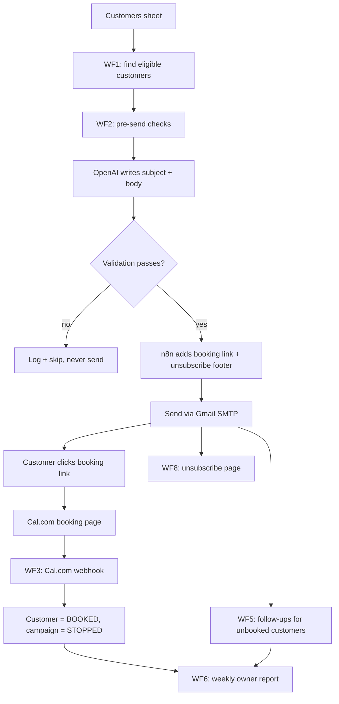

# Customer Reactivation Automation (n8n)

Win back inactive customers automatically. This n8n project finds past customers who haven't returned, sends each one a personalised email, points them to a booking page, detects when they book, stops further follow-ups, and emails the business owner a weekly report.

Built for service businesses (cleaning, HVAC, plumbing, salons, auto detailing and similar). Everything the owner needs to change lives in a Google Sheet. They never open n8n.

> **Design rule:** n8n is the boss, AI is the copywriter. Eligibility, consent, booking state, follow-up limits and every link in the email are decided by plain deterministic logic. OpenAI only writes the wording, and its output is validated before anything is sent.

## How it works



## Features

- **Safe by default.** Campaign switches `OFF` on any missing or invalid setting. Per-run send cap. Paced sending.
- **Never double-sends.** A send-key (`customer + campaign + sequence`) is logged *before* sending.
- **Consent-aware.** Only `OPTED_IN` customers are emailed. Own unsubscribe flow: the GET page only confirms, so email scanners cannot unsubscribe people by accident.
- **AI with guardrails.** The AI cannot invent links, prices, discounts or guarantees. Output that breaks the rules is discarded and logged.
- **Handles real-world bookings.** Verified (HMAC-signed) Cal.com webhooks, duplicate delivery, cancellations, reschedules, and bookings that match no customer.
- **Audit trail.** Every event goes to an append-only `Campaign_Log`. Failures go to an `Errors` sheet and alert the operator.
- **Reusable.** One workbook plus one copy of the workflows per client. No workflow edits per client.

## The workflows

| File | Name | Trigger | What it does |
|------|------|---------|--------------|
| `WF0_Get_Settings.json` | Get Settings | called by others | Reads the Settings sheet, validates it, returns one settings object |
| `WF1_Find_Eligible_Customers.json` | Find Eligible Customers | daily 09:00 | Data-quality check, eligibility filter, calls WF2 per customer |
| `WF2_Send_Campaign_Email.json` | Send Campaign Email | called by WF1/WF5 | Checks, OpenAI, validation, Gmail SMTP, logging |
| `WF3_CalCom_Booking_Webhook.json` | Cal.com Booking Webhook | webhook | Verifies signature, marks booked / cancelled / rescheduled |
| `WF5_Follow_up_Campaign.json` | Follow-up Campaign | daily 10:00 | Sends follow-ups to contacted, unbooked customers |
| `WF6_Weekly_Report.json` | Weekly Report | Monday 08:00 | Counts from `Campaign_Log`, writes `Results`, emails the owner |
| `WF7_Error_Handler.json` | Error Handler | on workflow error | Writes to `Errors`, emails the operator |
| `WF8_Unsubscribe_Handler.json` | Unsubscribe Handler | webhook | Confirm page, then unsubscribes on POST |

There is no WF4. It is reserved for Resend email-event tracking, which this build does not need (see [roadmap](docs/roadmap.md)).

## Stack

n8n (self-hosted Community Edition) · Google Sheets as the database · OpenAI `gpt-4o-mini` for copy · Gmail SMTP for sending · Cal.com for bookings · ngrok for local webhooks.

## Quick start

Full instructions are in [docs/setup.md](docs/setup.md). The short version:

1. **Prepare the sheet.** Create a Google Sheet with five tabs (`Customers`, `Settings`, `Campaign_Log`, `Results`, `Errors`) from [`sheet-template/`](sheet-template/). Share it with your Google service account as Editor.
2. **Configure n8n.** Set the environment variables from [`.env.example`](.env.example) and restart.
3. **Fill in your IDs** without touching the committed files:
   ```bash
   python scripts/configure.py --sheet-id YOUR_REAL_SHEET_ID
   ```
   This writes ready-to-import copies to `build/` (git-ignored).
4. **Import the workflows** from `build/` in the order given in the setup guide, then pick your credentials in each node.
5. **Test with the demo customers** following [docs/testing.md](docs/testing.md). Keep `campaign_enabled = OFF` until you are ready.

## Repository layout

```
workflows/        the 8 n8n workflow exports (sanitized)
sheet-template/   empty CSV headers for each sheet + sample-data/ demo customers
docs/             setup, architecture, data model, state machine, security, testing, deployment, roadmap
scripts/          sanitize.py (clean + leak check), configure.py (fill in your IDs), sample data generator
examples/         example email and weekly report
```

## Documentation

| Doc | Contents |
|-----|----------|
| [Setup](docs/setup.md) | Accounts, env vars, import order, credentials, Cal.com webhook |
| [Architecture](docs/architecture.md) | Workflow-by-workflow flow and design principles |
| [Data model](docs/data-model.md) | Every sheet, column and Settings key |
| [State machine](docs/state-machine.md) | Campaign, booking and consent states; eligibility rules |
| [Security](docs/security.md) | Webhook signing, unsubscribe design, secrets handling, consent |
| [Testing](docs/testing.md) | The demo test and the failure-test table |
| [Deployment](docs/deployment-vps.md) | Moving from local to a VPS |
| [Known limitations](docs/known-limitations.md) | What it does not do yet, honestly |
| [Roadmap](docs/roadmap.md) | Resend upgrade path and future ideas |

## Important notes

- **Consent is your responsibility.** The system only emails customers marked `OPTED_IN`; it cannot verify that the consent is real. Check the email-marketing and data-protection rules that apply to you and your customers (for example GDPR, CAN-SPAM, NDPA). This is not legal advice.
- **n8n licensing.** This repo's files are MIT-licensed, but n8n itself is under the [Sustainable Use License](https://docs.n8n.io/sustainable-use-license/). Running it for your own business or building automations for clients who cannot edit workflows is allowed. Reselling access to n8n is not. If you plan to manage several clients on one instance, check with n8n first.
- **Scale.** Built and tested at about 5 emails per run on a free Gmail account (500 recipients per day). For regular campaigns use a transactional provider such as Resend with a verified domain.

## Contributing

Issues and pull requests are welcome. Before committing any exported workflow, run `python scripts/sanitize.py` and then `python scripts/sanitize.py --check` (CI runs the same check). See [SECURITY.md](SECURITY.md).

## License

[MIT](LICENSE)
